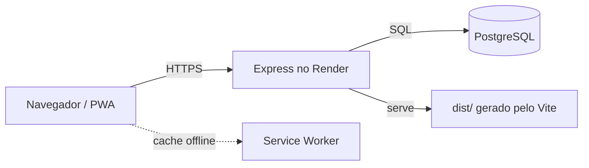

# LabEscola — Agendamentos CEPK

Sistema web de agendamento dos laboratórios e do auditório da escola. Professores entram com nome, e-mail e CPF, escolhem laboratório, data, turno, aulas e turma, e o sistema bloqueia automaticamente qualquer conflito de horário. Os dados ficam em um banco PostgreSQL e o front-end é um PWA instalável que também funciona offline para consulta.

- **Sistema online:** https://sistema-super-legal.onrender.com _(substituir pelo link gerado no Render)_
- **Repositório:** https://github.com/izabellahonoratosantos-source/sistema-super-legal

---

## Sumário

- [Funcionalidades](#funcionalidades)
- [Tecnologias](#tecnologias)
- [Arquitetura](#arquitetura)
- [Estrutura do projeto](#estrutura-do-projeto)
- [Banco de dados](#banco-de-dados)
- [API](#api)
- [Como rodar localmente](#como-rodar-localmente)
- [PWA](#pwa)
- [Deploy no Render](#deploy-no-render)
- [Testes](#testes)
- [Checklist do trabalho](#checklist-do-trabalho)

---

## Funcionalidades

- **Login/identificação** com nome, e-mail e validação de CPF (dígitos verificadores), tanto no navegador quanto no servidor.
- **CRUD completo de reservas**: criar, consultar, editar e excluir.
- **Controle de conflito** em três camadas: aviso na tela, validação na API e restrição `UNIQUE` no banco.
- **Permissão por professor**: só quem criou a reserva pode editar ou excluir (validado no servidor).
- **Calendário semanal** com atalho “Hoje”, indicador de dias com reservas e bloqueio de datas passadas.
- **Turnos e aulas** com recreio de 15 min após a 3ª aula; limite de aulas por turma.
- **Filtro por turno** na listagem de reservas.
- **PWA**: manifest, service worker, ícones, modo offline e botão “Instalar app”.
- **Interface responsiva** para celular, tablet e desktop.

## Tecnologias

| Camada | Tecnologia |
|---|---|
| Interface | React 19 + Vite 8, CSS puro |
| API | Node.js 22 + Express 5 |
| Banco | PostgreSQL (produção) / PGlite (desenvolvimento local) |
| Sessão | Token assinado com HMAC-SHA256 (`node:crypto`) |
| PWA | `manifest.json` + Service Worker nativo |
| Testes | `node:test` (nativo) |
| Deploy | Render (Web Service + PostgreSQL) |

## Arquitetura



O mesmo processo Node faz duas coisas: entrega o build do Vite (`dist/`) e expõe a API em `/api/*`. Em produção o Express conversa com o PostgreSQL do Render; em desenvolvimento, sem `DATABASE_URL`, ele usa o **PGlite** (PostgreSQL compilado para WebAssembly) gravando em `data/pglite` — o SQL é idêntico nos dois casos.

## Estrutura do projeto

```
sistema-super-legal/
├─ shared/
│  └─ dominio.js          # constantes e regras usadas pelo front E pelo back
├─ server/
│  ├─ app.js              # rotas da API, estáticos e tratamento de erros
│  ├─ db.js               # conexão PostgreSQL/PGlite + criação do esquema
│  ├─ repositorio.js      # consultas SQL (CRUD de reservas e usuários)
│  ├─ auth.js             # token HMAC e middleware de sessão
│  └─ seed.js             # dados de demonstração opcionais
├─ src/
│  ├─ api.js              # cliente HTTP (fetch + token)
│  ├─ components/
│  │  ├─ App.jsx          # telas de agendamento e resultado
│  │  └─ Login.jsx        # tela de login
│  ├─ hooks/
│  │  ├─ useInstalacao.js # prompt de instalação do PWA
│  │  └─ useOnline.js     # indicador de conexão
│  ├─ styles/             # index.css, App.css, Login.css
│  ├─ utils/datas.js      # helpers de data
│  └─ main.jsx            # ponto de entrada + registro do service worker
├─ public/
│  ├─ manifest.json       # manifesto do PWA
│  ├─ sw.js               # service worker (cache/offline)
│  ├─ offline.html        # página de fallback offline
│  └─ icons/              # ícones 192, 512, maskable e apple-touch
├─ scripts/
│  ├─ gerar-icones.mjs    # gera os PNGs sem dependências externas
│  └─ testar-api.mjs      # teste manual da API (servidor rodando)
├─ tests/api.test.js      # testes automatizados da API
├─ server.js              # inicialização do servidor
├─ render.yaml            # blueprint de deploy (web + banco)
└─ vite.config.js         # proxy /api em desenvolvimento
```

## Banco de dados

Três tabelas com chave estrangeira e restrição de unicidade:

```sql
usuarios (
  id TEXT PK, nome TEXT, email TEXT UNIQUE, cpf TEXT,
  criado_em TIMESTAMPTZ, atualizado_em TIMESTAMPTZ
)

reservas (
  id TEXT PK, lab_id TEXT, turno TEXT, data DATE,
  materia TEXT, turma TEXT, turma_nome TEXT, serie TEXT,
  professor TEXT, professor_email TEXT,
  criado_em TIMESTAMPTZ, atualizado_em TIMESTAMPTZ
)

horarios (
  lab_id TEXT, turno TEXT, data DATE, aula INTEGER,
  reserva_id TEXT REFERENCES reservas(id) ON DELETE CASCADE,
  PRIMARY KEY (lab_id, turno, data, aula)   -- impede choque de horário
)
```

- A tabela `horarios` guarda **uma linha por aula reservada**. A chave primária composta é o que garante, no próprio banco, que dois professores não peguem o mesmo laboratório na mesma aula.
- `ON DELETE CASCADE` remove os horários junto com a reserva.
- O esquema é criado automaticamente na primeira execução (`CREATE TABLE IF NOT EXISTS`).

## API

Todas as rotas de reservas exigem `Authorization: Bearer <token>` (obtido no login).

| Método | Rota | Descrição |
|---|---|---|
| `GET` | `/healthz` | Health check do Render |
| `GET` | `/api/health` | Status do serviço + banco + nº de reservas |
| `POST` | `/api/login` | Identifica o professor e devolve `{ usuario, token }` |
| `GET` | `/api/reservas` | Lista todas as reservas |
| `POST` | `/api/reservas` | Cria reserva |
| `PUT` | `/api/reservas/:id` | Atualiza reserva (somente o dono) |
| `DELETE` | `/api/reservas/:id` | Exclui reserva (somente o dono) |

Códigos de erro usados: `400` dados inválidos, `401` sem sessão, `403` reserva de outro professor, `404` não encontrada, `409` conflito de horário.

Exemplo de criação:

```bash
TOKEN=$(curl -s -X POST http://localhost:3000/api/login \
  -H 'content-type: application/json' \
  -d '{"nome":"Maria","email":"maria@escola.com.br","cpf":"529.982.247-25"}' \
  | node -pe 'JSON.parse(require("fs").readFileSync(0)).token')

curl -X POST http://localhost:3000/api/reservas \
  -H "authorization: Bearer $TOKEN" \
  -H 'content-type: application/json' \
  -d '{"labId":"lab1","turno":"manha","data":"2026-12-01","aulas":[1,2],"materia":"Física","turma":"2A"}'
```

## Como rodar localmente

Requisitos: **Node.js 22.12+** (veja `.node-version`).

```bash
npm install
```

### Opção 1 — desenvolvimento (hot reload)

Dois terminais:

```bash
# terminal 1: API + banco local (PGlite)
npm run dev:api

# terminal 2: Vite com proxy para a API
npm run dev
```

Abra `http://localhost:5173`.

### Opção 2 — produção local (igual ao Render)

```bash
npm run build
npm start
```

Abra `http://localhost:3000`. É o modo indicado para testar o PWA (instalação e offline), porque o service worker só é registrado no build de produção.

O banco local fica em `data/pglite`. Para começar do zero, apague essa pasta.

### Variáveis de ambiente

| Variável | Uso |
|---|---|
| `PORT` | Porta do servidor (padrão `3000`) |
| `DATABASE_URL` | String de conexão PostgreSQL. Se ausente, usa PGlite local |
| `SESSION_SECRET` | Segredo do HMAC dos tokens. Sem ele, um segredo aleatório é gerado a cada boot |
| `SEED_DEMO` | `true` cria 4 reservas de exemplo se o banco estiver vazio |

## PWA

- `public/manifest.json` com nome, cores, ícones 192/512/maskable, atalhos e `display: standalone`.
- `public/sw.js` com três estratégias:
  - **navegação**: rede primeiro, cai para o `index.html` em cache;
  - **API**: rede primeiro, guarda a última resposta para consulta offline;
  - **estáticos**: responde do cache e atualiza em segundo plano.
- Ícones gerados por `npm run icones` (`scripts/gerar-icones.mjs`), sem dependências externas.
- Botão **📲 Instalar app** aparece quando o navegador permite a instalação; no iOS use *Compartilhar → Adicionar à Tela de Início*.
- No logout, o cache da API é limpo para não exibir dados de outro professor.

**Como testar**

1. `npm run build && npm start`
2. Abra `http://localhost:3000` no Chrome.
3. DevTools → **Application → Manifest** (sem erros) e **Service Workers** (ativado).
4. DevTools → **Network → Offline**, recarregue: a tela continua abrindo com os últimos dados.
5. Lighthouse → categoria **PWA** deve indicar instalação disponível.

## Deploy no Render

O `render.yaml` já descreve tudo: um **Web Service** Node e um **PostgreSQL free**.

1. Entre em [dashboard.render.com](https://dashboard.render.com) com a conta do GitHub.
2. **New + → Blueprint** e selecione o repositório `sistema-super-legal`.
3. Confirme o serviço `sistema-super-legal` e o banco `labescola-db` e clique em **Apply**.
4. Aguarde o build (`npm ci --include=dev && npm run build`) e o start (`npm start`).
5. Acesse `https://<nome-do-servico>.onrender.com`.

Variáveis configuradas pelo blueprint:

| Variável | Valor |
|---|---|
| `NODE_VERSION` | `22.12.0` |
| `NODE_ENV` | `production` |
| `SESSION_SECRET` | gerado automaticamente pelo Render |
| `SEED_DEMO` | `true` (remova depois de validar) |
| `DATABASE_URL` | conexão interna do banco `labescola-db` |

> **Atenção ao plano free do Render:** o Web Service “dorme” após 15 minutos sem acesso (a primeira visita seguinte demora ~50 s) e o PostgreSQL free **expira 30 dias após a criação**. Para uma apresentação, crie o banco perto da data. Se precisar de algo permanente e gratuito, aponte `DATABASE_URL` para um PostgreSQL externo (por exemplo, Neon) e remova o bloco `databases`/`fromDatabase` do `render.yaml`.

## Testes

```bash
npm test          # testes automatizados da API (PGlite em memória)
npm run lint      # Oxlint
```

Os testes cobrem: login/CPF, exigência de sessão, criação, listagem, conflito de horário, validação de turma, edição, permissão de outro professor, exclusão e entrega do manifest.

Para testar a API manualmente com o servidor no ar:

```bash
node scripts/testar-api.mjs           # usa http://127.0.0.1:3100
API_BASE=http://127.0.0.1:3000 node scripts/testar-api.mjs
```

## Checklist do trabalho

| Requisito | Onde está |
|---|---|
| Interface visual funcional e responsiva | `src/components/`, `src/styles/` (media queries em 640px e 380px) |
| CRUD de dados | Rotas `POST/GET/PUT/DELETE /api/reservas` + telas de agendamento e resultado |
| Integração com banco de dados | `server/db.js` + `server/repositorio.js` (PostgreSQL; PGlite no dev) |
| Persistência dos dados | Tabelas `usuarios`, `reservas`, `horarios`; `DATABASE_URL` no Render |
| PWA: manifest + service worker | `public/manifest.json`, `public/sw.js`, registro em `src/main.jsx` |
| Instalação em dispositivos móveis | `display: standalone`, ícones maskable e botão “Instalar app” |
| Código no GitHub público | https://github.com/izabellahonoratosantos-source/sistema-super-legal |
| Publicação no Render | `render.yaml` + seção [Deploy no Render](#deploy-no-render) |
| Organização do código | `shared/`, `server/`, `src/`, `scripts/`, `tests/` com responsabilidades separadas |
| OpenCode como ferramenta de IA | Desenvolvimento assistido no OpenCode (este repositório foi construído/evoluído com ele) |

---

## Segurança e limitações

- A identificação usa nome, e-mail e CPF, **sem senha**. O CPF é validado, mas não é um fator secreto — o objetivo é identificar o professor, não proteger uma conta bancária. Para uso real, o próximo passo seria senha (hash Argon2/bcrypt) ou login institucional.
- O token é assinado (HMAC) e expira em 12 horas; fica em `sessionStorage` e não é acessível por outro site.
- O servidor valida tudo novamente: formato de data, laboratório, turno, turma, limite de aulas, conflito e autoria da reserva.
- Concorrência: além da checagem na API, a chave `PRIMARY KEY (lab_id, turno, data, aula)` impede dupla reserva mesmo com dois cliques simultâneos.
